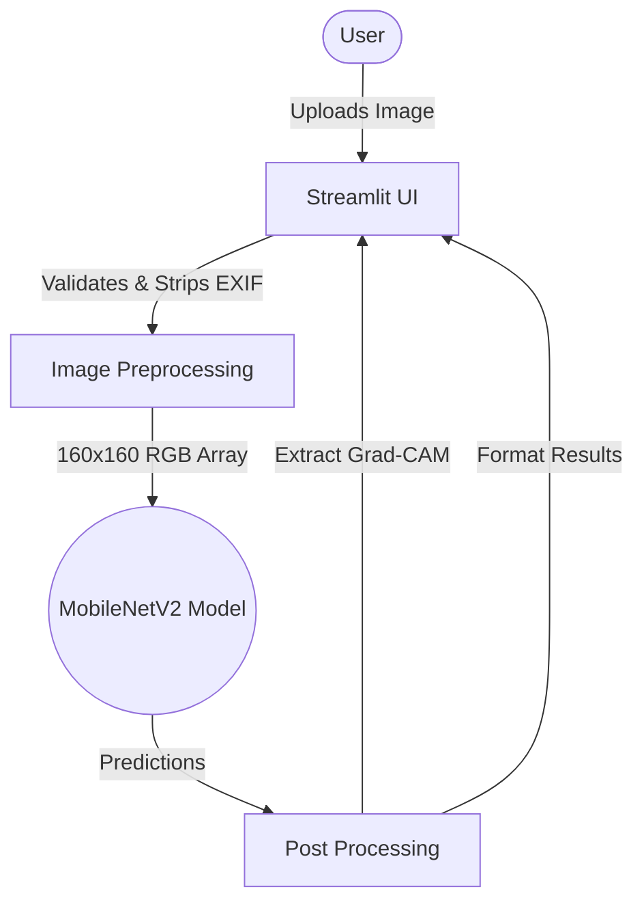

# Brain Tumor Detection App 🧠

**🔗 Live demo:** (https://braintumordetection-rokxus5q4va4crbfjdkbss.streamlit.app/)

A Streamlit web app that classifies brain MRI scans into four classes using a CNN (MobileNetV2 transfer learning).

> ⚠️ **For educational use only. Not a diagnostic tool.**

## Features
- **Analyze MRI**: Upload an MRI to get a predicted class, confidence threshold warnings, top-2 predictions, and a Grad-CAM focus overlay.
- **Batch Processing**: Upload multiple images at once and download a CSV report.
- **Compare Scans**: Upload two scans to view predictions and probability charts side-by-side.
- **Downloadable PDF Report**: Export the analysis, confidence, and medical overview as a lightweight PDF.
- **In-Memory & Privacy First**: Images are never saved to disk, and all EXIF metadata is automatically stripped before processing.
- **Educational Content**: Read detailed information regarding symptoms, causes, and treatments for each condition.

## Architecture



## Real Metrics (1,600 held-out test images)
- **Test Accuracy**: 85.25%
- **Macro F1 Score**: 0.848

**Per Class Metrics:**
| Class | Precision | Recall | F1 Score |
|-------|-----------|--------|----------|
| Glioma | 0.942 | 0.725 | 0.819 |
| Meningioma | 0.827 | 0.695 | 0.755 |
| No Tumor | 0.906 | 0.993 | 0.947 |
| Pituitary | 0.770 | 0.998 | 0.869 |

**Confusion Matrix (True \ Predicted):**
| True \ Pred | Glioma | Meningioma | No Tumor | Pituitary |
|---|---|---|---|---|
| **Glioma** | 290 | 56 | 26 | 28 |
| **Meningioma** | 17 | 278 | 15 | 90 |
| **No Tumor** | 0 | 2 | 397 | 1 |
| **Pituitary** | 1 | 0 | 0 | 399 |

## Model Card
- **Data Source**: [Brain Tumor MRI Dataset](https://www.kaggle.com/datasets/masoudnickparvar/brain-tumor-mri-dataset) (7,200 images total, 1600 held out for testing).
- **Intended Use**: Educational exploration of CNN performance on medical imaging tasks.
- **Out-of-Scope Use**: Absolutely no medical diagnosis, triage, or clinical decision support.
- **Known Failure Modes**: 
  - Misses ~28% of Gliomas and ~30% of Meningiomas due to lower recall.
  - Can be confused by extreme noise, artifacts, or images that are not grayscale MRI slices.

## Limitations
- Trained on a single public dataset; not validated on diverse or clinical data.
- Low recall for glioma (0.725) and meningioma (0.695) means tumors can easily be missed.
- **For educational use only.**

## Run Locally
1. Clone this repository.
2. Install dependencies:
   ```bash
   pip install -r requirements.txt
   ```
3. Run the application:
   ```bash
   streamlit run braintumorapp.py
   ```

## Test Instructions
To run the automated tests suite:
```bash
python -m pytest tests/
```

## Project Structure
```
├── braintumorapp.py       # Streamlit app entry point
├── model.keras            # Trained Keras model
├── train.py               # Reproducible training script
├── requirements.txt       # Pinned dependencies
├── .streamlit/            # Streamlit theme and configuration
├── src/                   # Core application logic
│   ├── config.py          # Application constants
│   ├── content.py         # Medical context and conditions data
│   ├── inference.py       # Prediction, preprocessing, Grad-CAM
│   ├── report_generator.py# PDF exporting logic
│   ├── ui_components.py   # Reusable UI widgets
│   └── utils.py           # Logging utilities
└── tests/                 # Pytest test suite
```
